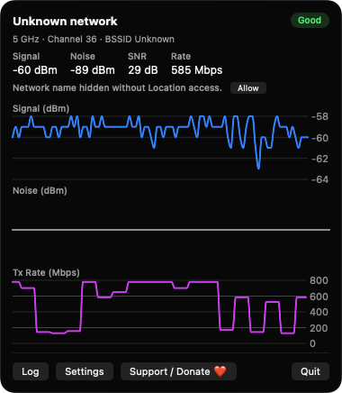
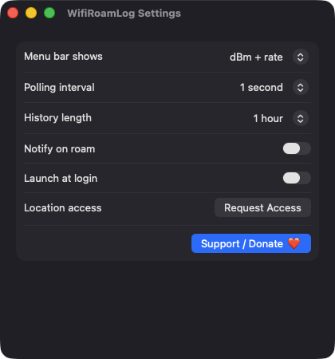
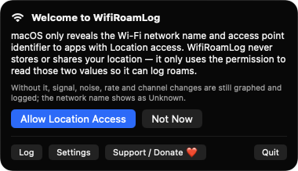

# WifiRoamLog

**🌐 Website:** [turhe123.github.io/wifi-roam-log](https://turhe123.github.io/wifi-roam-log/)

Graph Wi-Fi signal, noise and rate live and keep a log of every roam and channel change.


## Why

WifiRoamLog is a free, open-source, 100% native, backend-free alternative to paid utilities in the *System Monitoring* category. It was inspired by "WiFi Signal ($4.99 one-time)", a long-standing utility for people debugging flaky wireless. WifiRoamLog focuses on radio-level history and event logging. Everything runs locally on your Mac: there is no server, no account and no telemetry.

## Features

- **Menu bar status** in a window-style `MenuBarExtra`, showing either dBm + rate, a percentage, or a quality rating.
- **Live polling** of the built-in Wi-Fi interface (CoreWLAN) every 1, 2 or 5 seconds.
- **Three stacked Swift Charts** for signal (dBm), noise (dBm) and transmit rate (Mbps).
- **Header details**: network name, band, channel, BSSID, signal, noise, SNR and rate.
- **Quality rating** (Poor / Fair / Good / Excellent) derived from signal-to-noise ratio.
- **In-memory history** of 15 minutes, 30 minutes or 1 hour.
- **Persistent event log** (JSON lines in `~/Library/Application Support/WifiRoamLog/events.jsonl`), capped at 10,000 entries with the oldest trimmed.
- **Detected events**: network switch, roam to another access point (BSSID), channel change, band change, connect, disconnect (including Wi-Fi turned off), and wake from sleep.
- **Log window** with time, event, old value, new value and note, newest first, plus **Clear** (with confirmation) and **Export** to a plain-text file.
- **Optional notifications** on roams and channel changes.
- **Sleep/wake handling**: polling pauses during sleep and a wake marker is logged.
- **Clear states** when Wi-Fi is off (with a button to open Network settings) or no built-in interface exists. External USB Wi-Fi adapters are not supported.
- **Launch at login** via `SMAppService`.

## Screenshots

<p align="center"></p>

<p align="center"><em>The menu bar popover graphs live Wi-Fi signal, noise and transmit rate, with band, channel, SNR and a quality rating up top.</em></p>

<p align="center"></p>

<p align="center"><em>Settings let you choose the menu bar format, polling interval, history length, roam notifications and launch at login.</em></p>

<p align="center"></p>

<p align="center"><em>On first launch, WifiRoamLog explains why it asks for Location access and works without it if you decline.</em></p>

## Install

1. Download `WifiRoamLog-macOS.zip` from the [latest release](https://github.com/turhe123/wifi-roam-log/releases/latest).
2. Unzip it and move `WifiRoamLog.app` to `/Applications`.
3. Because the app is open source and not notarized, clear the quarantine attribute:

   ```bash
   xattr -cr /Applications/WifiRoamLog.app
   ```

4. Right-click the app and choose **Open** the first time you launch it.

## Build from source

Requires Xcode with a macOS 14+ SDK.

```bash
brew install xcodegen
xcodegen generate
xcodebuild -project WifiRoamLog.xcodeproj -scheme WifiRoamLog -configuration Release -derivedDataPath ./build build
```

The app is produced at `build/Build/Products/Release/WifiRoamLog.app`.

## Permissions

WifiRoamLog asks for as little as possible. It does **not** request Accessibility, Screen Recording or Microphone access.

- **Location (When In Use)**: macOS only reveals the Wi-Fi network name (SSID) and access point identifier (BSSID) to apps with Location permission. Your location is never read, stored or sent anywhere. If you decline, signal, noise, rate and channel changes are still graphed and logged, but the network name shows as Unknown and roams between access points on the same channel may not be detected.
- **Notifications** (optional): requested only when you enable "Notify on roam".
- **Login item** (optional): used only if you enable "Launch at login".

## Support ❤️

If WifiRoamLog is useful to you, you can help keep the project going:

[Support Or (Leo) Davidai ❤️](https://ko-fi.com/leodavidai)

## License

MIT © Or Davidai Bachar
